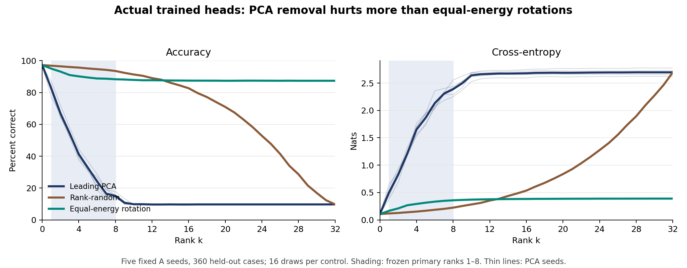

# Leading hidden PCs matter to these trained frozen heads

Completed 24 October 2026. A bounded, prospective protocol on a reused digit benchmark.

## What actually happened

Ten small neural networks were fitted, and a separately gated held-out sweep evaluated their original output heads without refitting. For the five fully trained models, removing leading hidden principal components caused **1.325640 nats more cross-entropy** than paired equal-norm random-orientation perturbations, averaged over the predeclared ranks 1 through 8. The conditional 95% case-bootstrap interval was **[1.246820, 1.404320]**. All five seed effects were positive: **1.387076, 1.425428, 1.311884, 1.274348, 1.229465** nats.

This meets the predeclared supporting-evidence rule: positive lower interval bound and at least four of five positive seed effects. It establishes a narrow causal sensitivity of these frozen classifiers to these artificial activation edits. It does **not** establish a natural representational mechanism, semantic localization, irreversible information loss, biological relevance, or a novel general law.

## Performance, not just geometry

Clean test accuracy averaged **97.22%** across the five fully trained models. Over primary ranks 1–8, PCA-edited accuracy averaged **41.63%**, versus **90.55%** for the equal-energy controls. Their mean perturbation norms were identical, **4.0170**, by construction and independently checked. Rank-matched random projections had a smaller mean norm, **1.6988**, and **95.30%** accuracy; that comparison alone would confound direction with magnitude.

Selected ranks below are descriptive landmarks, not newly selected endpoints. Every rank from 0 through 32 and every seed/control is retained in the dense curves.

| Rank | PCA removal accuracy | Rank-random accuracy | Equal-energy accuracy |
|---:|---:|---:|---:|
| 0 | 97.22% | 97.22% | 97.22% |
| 1 | 82.39% | 96.82% | 94.96% |
| 2 | 66.83% | 96.43% | 93.11% |
| 4 | 41.11% | 95.64% | 90.14% |
| 8 | 15.11% | 93.51% | 88.31% |
| 16 | 9.67% | 82.68% | 87.46% |
| 32 | 9.72% | 9.72% | 87.38% |

Lines average the five A models and, for each random-control family, 16 draws. Faint PCA lines show individual seeds; shaded ranks 1–8 were selected before execution. No uncertainty bands are implied. The full-rank PCA/rank-random endpoint is the constant training mean, an architectural check rather than a discovery. Equal-energy rotations are not projections, so they need not share that endpoint.

## The experiment

The sklearn digits dataset supplied 1,797 examples, split into 1,078 training, 359 validation, and 360 test cases using frozen stratified split seeds. “Held-out” means excluded from fitting and selection in this run. This is a historically reused benchmark, **not new data or a writer-held-out test**.

Five fixed seeds each initialized a float64 64→32 ReLU→10-logit MLP. Arm A trained all parameters. Arm B froze the initial hidden weights/biases and trained only its output head. Each pair shared initialization and exact batch order. All ten fits completed the prescribed 250 Adam epochs; there was no early stopping, tuning, seed replacement, or convergence claim.

Mean and PCA were fitted only to training hidden states. For each test state, the intervention subtracted the leading k-dimensional centered PCA projection while preserving the training mean, then applied the **original frozen head**. Controls were 16 seeded rank-matched orthogonal projections and 16 independent rotations of the removed vector, matched in norm for every case/rank. No second ReLU, clipping, or head/probe refit was applied. The equal-energy control is an orientation perturbation, **not** a random orthogonal projection. Details, RNG recipes, falsifiers, and resource ceilings are in the unchanged [frozen protocol](../source/PROTOCOL.md).

The primary statistic averages the case-paired PCA-minus-energy loss difference across ranks 1–8 and five A seeds. A 10,000-draw paired case bootstrap preserves each case's seed/rank/control pairing. Its interval is conditional on these fitted models and sampled directions; it does **not** estimate writer variation, training-seed uncertainty, or random-control Monte Carlo uncertainty.

## The trained-versus-random comparison failed

**INELIGIBLE.** All A validation accuracies passed the 90% competence floor (95.82–96.66%). B validation accuracies were only **75.21–86.07%**, so the prescribed pairwise competence gate failed. The complete B sweep remains in the archive, but B and A-minus-B numerical effects are descriptive only and provide **no learning-specific conclusion**. The failure was not repaired by extra training or selective reporting.

Even matched accuracies would not equate output-head calibration, logit scale, margins, or weight geometry. A larger A effect by itself would not isolate representation learning. Chance-level wholly untrained predictions are not evidence of robustness.

## Important off-support limitation

ReLU hidden states are naturally nonnegative. These interventions sometimes created materially negative coordinates, hence states outside that support. Across A primary ranks 1–8, strict `< 0` counts were **4.58% of PCA coordinates** and **16.63% of energy-control coordinates**; at least one negative occurred in **75.8%** and **99.3%** of the respective case/seed/rank/control combinations.

A separately labeled **post-run numerical diagnostic**, not a revised metric or endpoint, distinguished roundoff using `< −1e−10`. The corresponding PCA rates were **1.80% of coordinates** and **40.4% of combinations**; energy-control rates remained **16.63%** and **99.3%**. All full-rank PCA/rank-random negatives were within that tolerance. Nonnegative edited states can also be out of distribution. These unequal support violations neither explain away nor validate the observed excess; they limit its interpretation to the specified artificial edits, not natural activation removal.

## Verification and budgets

The protocol/source passed 40 synthetic tests and an independent review before training. Training artifacts passed a separate review before held-out execution. The final independent audit checked **all 10,890 model-arm/rank/condition cells**, original frozen-head and training-geometry binding, exact seeded controls, full dataset hash and split, full-logit statistics, bootstrap/signs/decisions, endpoints, and per-example energy equality. Maximum reconstructed-logit error was **1.07×10⁻¹⁴**. This was independent auditing/rescoring, **not independent retraining or independent data collection**.

All ten fits ran once in **14.21 seconds** by the wall watchdog; the full held-out stage ran once in **21.21 seconds**. Peak recorded RSS was **129.0 MB** and **239.3 MB**, respectively. Each stage stayed below its 600-second, 1-GiB-RSS, 512-MiB-output ceilings with two BLAS threads. Resource checks were single-process accounting plus a wall watchdog, not kernel containment. The read-only full audit took 11.31 seconds using a reviewed decompression cache; the frozen experiment source was not changed.

The source, training archive, and approximately 315 MB held-out archive were durably retained and fully read back with matching SHA-256 hashes. [Evidence references](../EVIDENCE.json) identify them. This compact package includes source, all curve rows, summaries and verification receipts, **not the complete raw logits or public download access to them**. Full independent rescoring requires those retained archives; hashes alone do not prove provenance.

## What remains unproved

The result is conditional on one reused split, five fixed models, a small architecture, the chosen hidden coordinate system, and artificial perturbations. Redundant information could remain or be recoverable by another head or retraining. Nothing here distinguishes all such alternatives or transfers the result to language models or brains. Centering invariance and the full-rank mean endpoint are pipeline checks, not empirical discoveries. This study adds actual trained-head evidence to the prior digit/probe analysis, without replacing or extending any separate activation-copying experiment.

## Attribution and sources

- [Public repository baseline](https://github.com/EastonSell/what-activations-do/tree/baa500a5567b3845513edb52d9b241edbeb45bab), including [the original digit runner](https://github.com/EastonSell/what-activations-do/blob/baa500a5567b3845513edb52d9b241edbeb45bab/run_digits.py).
- E. Alpaydin and C. Kaynak, [Optical Recognition of Handwritten Digits](https://archive.ics.uci.edu/dataset/80/optical+recognition+of+handwritten+digits), UCI Machine Learning Repository, 1998, CC BY 4.0. This run uses the [scikit-learn 1.8 digits loader](https://scikit-learn.org/1.8/modules/generated/sklearn.datasets.load_digits.html), scales pixels by 1/16, and applies the stated split and model.
- D. P. Kingma and J. Ba, [Adam: A Method for Stochastic Optimization](https://arxiv.org/abs/1412.6980). The explicit optimizer implementation and its precise settings are frozen in this package.
